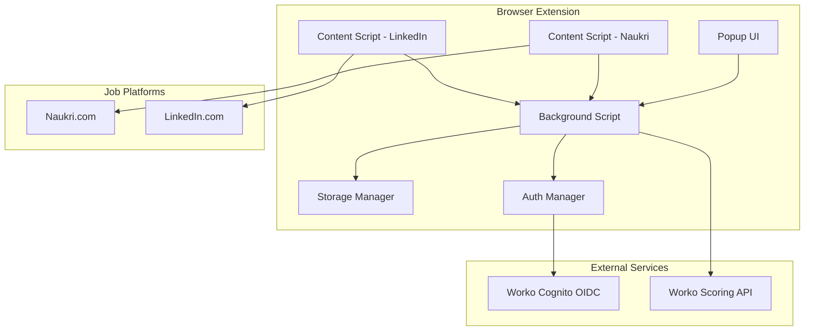
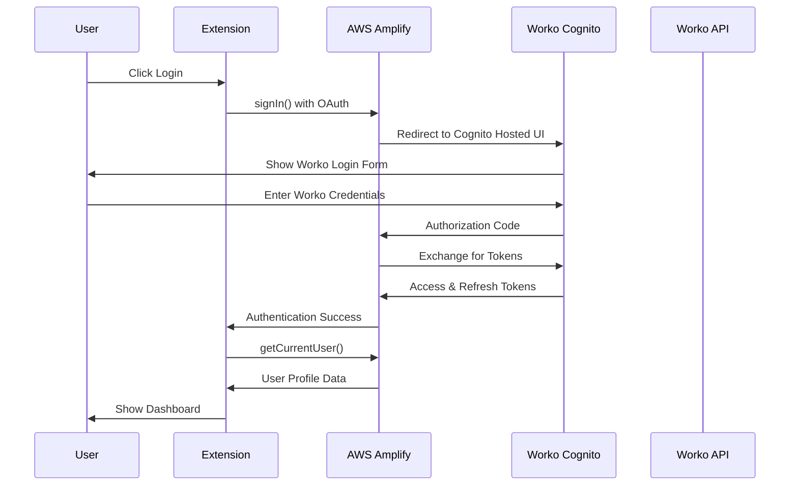
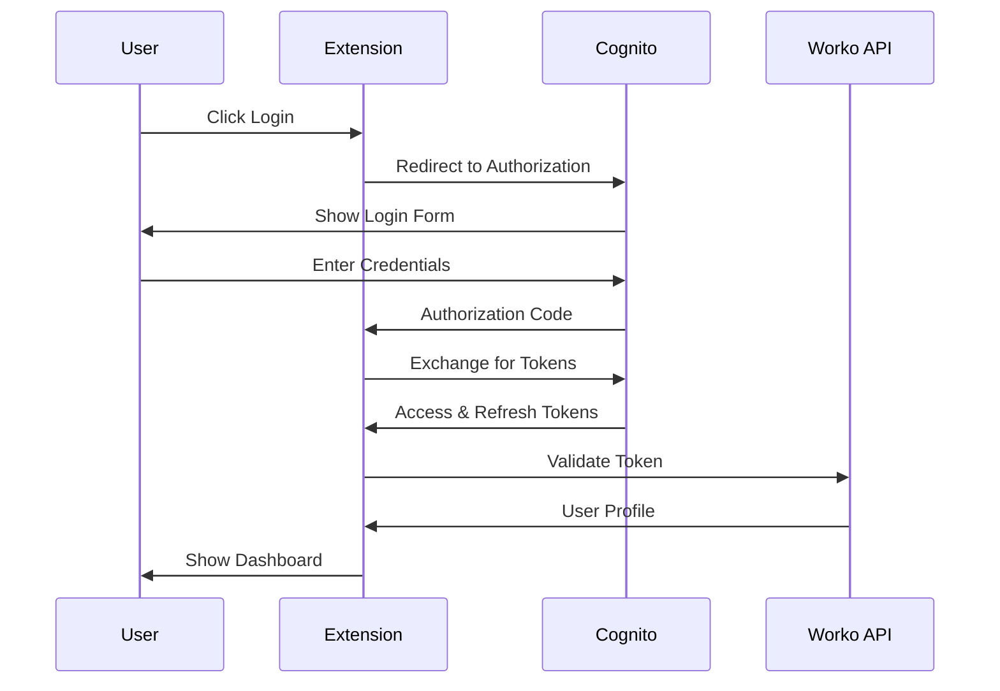

# Design Document - Worko Browser Extension Phase 1

## Overview

The Worko Browser Extension is a cross-browser extension that integrates with job platforms (Naukri and LinkedIn) to provide real-time job matching scores. The extension uses a multi-component architecture with background scripts, content scripts, and popup interfaces to deliver seamless job scoring functionality while maintaining security and performance.

## Architecture

### High-Level Architecture



### Component Architecture

1. **Popup Interface**: Main user interface for authentication, score history, and controls
2. **Background Script**: Central coordinator handling API calls, authentication, and data management
3. **Content Scripts**: Platform-specific scripts for job description extraction
4. **Storage Manager**: Secure data persistence and retrieval
5. **Authentication Manager**: OIDC flow handling and token management

## API Integration

### Worko API Endpoints

Based on the existing Worko API structure, the browser extension will integrate with the following endpoints:

#### Authentication APIs
- **Base URL**: `https://api.worko.ai` (production) / `https://dev-api.worko.ai` (development)
- **Authentication**: Cognito OIDC with JWT tokens
- **Authorization**: Custom Lambda authorizer (`worko-auth`)

#### User Profile APIs
```typescript
// Get user basic details
GET /user/basic-details
Authorization: Bearer {accessToken}

// Get user profile details
GET /user/{userId}/profile
Authorization: Bearer {accessToken}

// Get user skills
GET /user/{userId}/skills
Authorization: Bearer {accessToken}

// Get user experience
GET /user/{userId}/experience
Authorization: Bearer {accessToken}
```

#### Local Job Matching Logic
The extension will implement local job matching calculation similar to the worko-ui-react application, eliminating the need for API calls for scoring:

```typescript
// Local job matching service
class LocalJobMatchingService {
  calculateJobScore(jobData: JobData, userProfile: UserProfile): ScoreResponse {
    const breakdown = {
      experienceScore: this.calculateExperienceMatch(jobData, userProfile),
      skillsScore: this.calculateSkillsMatch(jobData, userProfile),
      educationScore: this.calculateEducationMatch(jobData, userProfile),
      locationScore: this.calculateLocationMatch(jobData, userProfile),
      industryScore: this.calculateIndustryMatch(jobData, userProfile),
      roleScore: this.calculateRoleMatch(jobData, userProfile),
      responsibilitiesScore: this.calculateResponsibilitiesMatch(jobData, userProfile)
    };

    const overallScore = this.calculateOverallScore(breakdown);
    
    return {
      matchingScore: overallScore,
      breakdown,
      explanation: this.generateExplanations(breakdown, jobData, userProfile),
      overallExplanation: this.generateOverallExplanation(overallScore, breakdown)
    };
  }

  private calculateExperienceMatch(jobData: JobData, userProfile: UserProfile): number {
    // Logic to match required experience vs user experience
    const requiredExp = this.extractRequiredExperience(jobData.description);
    const userExp = userProfile.experience;
    
    if (userExp >= requiredExp) return 100;
    if (userExp >= requiredExp * 0.8) return 85;
    if (userExp >= requiredExp * 0.6) return 70;
    return Math.max(0, (userExp / requiredExp) * 100);
  }

  private calculateSkillsMatch(jobData: JobData, userProfile: UserProfile): number {
    const requiredSkills = this.extractSkillsFromJobDescription(jobData.description);
    const userSkills = userProfile.skills.map(s => s.toLowerCase());
    
    const matchedSkills = requiredSkills.filter(skill => 
      userSkills.some(userSkill => 
        userSkill.includes(skill.toLowerCase()) || 
        skill.toLowerCase().includes(userSkill)
      )
    );
    
    return Math.min(100, (matchedSkills.length / requiredSkills.length) * 100);
  }

  // Additional matching methods for education, location, industry, etc.
}
```

#### Job History Storage
Job scoring history will be stored locally in the browser extension storage for privacy and performance:

```typescript
// Local storage schema for job history
interface JobHistoryStorage {
  jobScores: JobScore[];
  maxHistorySize: 50; // Keep last 50 scored jobs
}

interface JobScore {
  id: string;
  jobData: JobData;
  score: number;
  breakdown: ScoreBreakdown;
  timestamp: number;
  applied: boolean;
  platform: 'naukri' | 'linkedin';
}

// Storage service for job history
class JobHistoryService {
  async saveJobScore(jobScore: JobScore): Promise<void> {
    const history = await this.getJobHistory();
    history.unshift(jobScore); // Add to beginning
    
    // Keep only last 50 entries
    if (history.length > 50) {
      history.splice(50);
    }
    
    await chrome.storage.local.set({ jobScores: history });
  }

  async getJobHistory(limit: number = 5): Promise<JobScore[]> {
    const result = await chrome.storage.local.get(['jobScores']);
    const history = result.jobScores || [];
    return history.slice(0, limit);
  }
}
```

### Local Processing Benefits

The extension uses local processing instead of API calls for job scoring:

1. **Privacy**: Job descriptions and user data stay local
2. **Performance**: Instant scoring without network latency
3. **Offline Capability**: Works without internet connection
4. **Cost Efficiency**: No API usage costs
5. **Reliability**: No dependency on external services

## Components and Interfaces

### 1. Popup Interface (`popup.html`, `popup.js`, `popup.css`)

**Purpose**: Primary user interface for the extension

**Key Features**:
- Authentication interface with Worko login
- Dashboard showing last 5 scored jobs with color-coded results
- Job scoring controls and status indicators
- Settings and logout functionality

**Interface Design**:

#### Login State
```
┌─────────────────────────────┐
│    🚀 Worko Job Matcher    │
├─────────────────────────────┤
│                             │
│   Welcome to Worko!         │
│                             │
│   Connect your account to   │
│   start scoring jobs        │
│                             │
│   ┌─────────────────────┐   │
│   │   🔐 Login with     │   │
│   │      Worko          │   │
│   └─────────────────────┘   │
│                             │
│   Secure OIDC Authentication│
└─────────────────────────────┘
```

#### Main Dashboard
```
┌─────────────────────────────┐
│ 🚀 Worko Job Matcher       │
├─────────────────────────────┤
│ 👤 John Doe                │
│ ⚙️ Settings    🚪 Logout    │
├─────────────────────────────┤
│ 📊 Recent Job Scores        │
│                             │
│ 🟢 Software Engineer   85%  │
│    TechCorp • Naukri        │
│    [View] [Apply Now]       │
│                             │
│ 🟡 Product Manager     62%  │
│    StartupXYZ • LinkedIn    │
│    [View] [Apply Now]       │
│                             │
│ 🟠 Data Analyst        45%  │
│    DataCorp • Naukri        │
│    [View] [Apply Now]       │
│                             │
│ 🔴 DevOps Engineer     28%  │
│    CloudTech • LinkedIn     │
│    [View] [Apply Now]       │
│                             │
│ 🟡 UI Designer         71%  │
│    DesignStudio • Naukri    │
│    [View] [Apply Now]       │
│                             │
├─────────────────────────────┤
│ ┌─────────────────────────┐ │
│ │  📈 Score Current Job   │ │
│ └─────────────────────────┘ │
└─────────────────────────────┘
```

#### Job Scoring in Progress
```
┌─────────────────────────────┐
│ 🚀 Worko Job Matcher       │
├─────────────────────────────┤
│ 📊 Analyzing Job...         │
│                             │
│ 🔄 Extracting job details   │
│ ✅ Sending to Worko API     │
│ ⏳ Calculating match score  │
│                             │
│ ┌─────────────────────────┐ │
│ │ ████████████░░░░  75%   │ │
│ └─────────────────────────┘ │
│                             │
│ Please wait while we        │
│ analyze this opportunity... │
└─────────────────────────────┘
```

#### Score Results Detail View
```
┌─────────────────────────────┐
│ 🚀 Worko Job Matcher       │
├─────────────────────────────┤
│ 🟢 85% Match Score          │
│                             │
│ 📋 Software Engineer        │
│ 🏢 TechCorp                 │
│ 📍 Bangalore, India         │
│                             │
│ 📊 Score Breakdown:         │
│ Skills Match      🟢 92%    │
│ Experience        🟢 85%    │
│ Location          🟡 70%    │
│ Industry          🟢 95%    │
│                             │
│ ✅ Matching Skills:         │
│ • JavaScript, React, Node   │
│ • AWS, Docker, MongoDB      │
│                             │
│ ⚠️ Missing Skills:          │
│ • Kubernetes, GraphQL       │
│                             │
│ ┌─────────────────────────┐ │
│ │     🎯 Apply Now        │ │
│ └─────────────────────────┘ │
│                             │
│ [← Back to Dashboard]       │
└─────────────────────────────┘
```

### 2. Background Script (`background.js`)

**Purpose**: Central service worker managing all extension operations

**Key Responsibilities**:
- Handle authentication flow coordination
- Manage API communications with Worko services
- Coordinate between popup and content scripts
- Handle data persistence and retrieval
- Manage extension lifecycle events

**API Client Implementation**:
```javascript
class WorkoAPIClient {
  constructor() {
    this.baseURL = process.env.NODE_ENV === 'production' 
      ? 'https://api.worko.ai' 
      : 'https://dev-api.worko.ai';
    this.tokenManager = new TokenManager();
  }

  async makeAuthenticatedRequest(endpoint, options = {}) {
    try {
      const token = await this.tokenManager.getValidToken();
      
      const defaultOptions = {
        headers: {
          'Content-Type': 'application/json',
          'Authorization': `Bearer ${token}`,
          ...options.headers
        }
      };

      const response = await fetch(`${this.baseURL}${endpoint}`, {
        ...defaultOptions,
        ...options
      });

      if (!response.ok) {
        throw new Error(`API request failed: ${response.statusText}`);
      }

      return await response.json();
    } catch (error) {
      console.error('API request error:', error);
      throw error;
    }
  }

  async getUserBasicDetails() {
    return await this.makeAuthenticatedRequest('/user/basic-details');
  }

  async getUserProfile(userId) {
    return await this.makeAuthenticatedRequest(`/user/${userId}/profile`);
  }

  async getUserSkills(userId) {
    return await this.makeAuthenticatedRequest(`/user/${userId}/skills`);
  }

  async getUserExperience(userId) {
    return await this.makeAuthenticatedRequest(`/user/${userId}/experience`);
  }

  async getUserEducation(userId) {
    return await this.makeAuthenticatedRequest(`/user/${userId}/education`);
  }

  // Note: Job scoring is done locally, not via API
  // These methods are kept for potential future API integration
  async saveJobScoreToAPI(userId, jobScoreData) {
    return await this.makeAuthenticatedRequest(`/user/${userId}/job-scores`, {
      method: 'POST',
      body: JSON.stringify(jobScoreData)
    });
  }
}
```

**Message Interface**:
```javascript
// Message handling interface
{
  type: 'AUTHENTICATE' | 'SCORE_JOB' | 'GET_HISTORY' | 'APPLY_JOB' | 'GET_USER_PROFILE',
  payload: any,
  tabId?: number
}
```

### 3. Content Scripts

#### Content Script UI Integration

**Naukri Integration**:
```
┌─────────────────────────────────────────────────────────┐
│ Naukri.com - Job Details Page                          │
├─────────────────────────────────────────────────────────┤
│ Software Engineer - TechCorp                           │
│ 💰 ₹8-12 LPA  📍 Bangalore  ⏰ 2-5 years             │
│                                                         │
│ ┌─────────────────────────────────────────────────────┐ │
│ │ 🚀 Worko Job Matcher                    [Score Job] │ │ ← Injected
│ └─────────────────────────────────────────────────────┘ │
│                                                         │
│ Job Description:                                        │
│ We are looking for a skilled Software Engineer...      │
│                                                         │
│ Requirements:                                           │
│ • 3+ years experience in JavaScript                    │
│ • Experience with React, Node.js                       │
│ ...                                                     │
└─────────────────────────────────────────────────────────┘
```

**LinkedIn Integration**:
```
┌─────────────────────────────────────────────────────────┐
│ LinkedIn - Job Details                                  │
├─────────────────────────────────────────────────────────┤
│ Product Manager at StartupXYZ                          │
│ 📍 Remote  ⏰ Full-time  👥 50-200 employees           │
│                                                         │
│ ┌─────────────────────────────────────────────────────┐ │
│ │ 🚀 Worko Match: 62% 🟡        [View Details] [Apply]│ │ ← Injected
│ └─────────────────────────────────────────────────────┘ │
│                                                         │
│ About the job                                           │
│ We're seeking a Product Manager to lead our...         │
│                                                         │
│ [Easy Apply] [Save] [More...]                          │
└─────────────────────────────────────────────────────────┘
```

**Floating Action Button (Alternative)**:
```
                                    ┌─────────────────┐
                                    │ 🚀 Worko        │
                                    │                 │
                                    │ Score: 85% 🟢   │
                                    │                 │
                                    │ [View] [Apply]  │
                                    └─────────────────┘
                                           ↑
                                    Floating overlay
```

#### Naukri Content Script (`content-naukri.js`)

**Purpose**: Extract job descriptions from Naukri job pages

**Key Features**:
- Detect job listing pages
- Extract job title, company, description, and requirements
- Inject scoring UI elements
- Handle "Apply Now" redirections

**Job Data Extraction**:
```javascript
interface NaukriJobData {
  title: string;
  company: string;
  description: string;
  requirements: string;
  location: string;
  url: string;
  platform: 'naukri';
}
```

#### LinkedIn Content Script (`content-linkedin.js`)

**Purpose**: Extract job descriptions from LinkedIn job pages

**Key Features**:
- Detect LinkedIn job pages
- Extract job information from LinkedIn's dynamic content
- Handle LinkedIn's SPA navigation
- Inject scoring UI elements

**Job Data Extraction**:
```javascript
interface LinkedInJobData {
  title: string;
  company: string;
  description: string;
  requirements: string;
  location: string;
  url: string;
  platform: 'linkedin';
}
```

### 4. Authentication Manager (`auth.js`)

**Purpose**: Handle OIDC authentication flow with Worko Cognito

**Key Features**:
- Initiate OIDC authorization flow using existing Worko Cognito configuration
- Handle callback and token exchange
- Manage token refresh
- Secure token storage

**AWS Amplify Integration**:
Following the worko-ui-react implementation pattern, the extension will use AWS Amplify for Cognito OIDC authentication:

```javascript
// Amplify configuration for browser extension
import { Amplify } from 'aws-amplify';
import { signIn, signOut, getCurrentUser, fetchAuthSession } from 'aws-amplify/auth';

const amplifyConfig = {
  Auth: {
    Cognito: {
      userPoolId: process.env.WORKO_COGNITO_USER_POOL_ID,
      userPoolClientId: process.env.WORKO_COGNITO_CLIENT_ID,
      loginWith: {
        oauth: {
          domain: process.env.WORKO_COGNITO_DOMAIN,
          scopes: ['openid', 'email', 'profile'],
          redirectSignIn: [chrome.identity.getRedirectURL()],
          redirectSignOut: [chrome.identity.getRedirectURL()],
          responseType: 'code'
        }
      }
    }
  }
};

Amplify.configure(amplifyConfig);
```

**Authentication Flow**:


**Amplify Authentication Manager**:
```javascript
class AmplifyAuthManager {
  async initializeAuth() {
    try {
      const user = await getCurrentUser();
      const session = await fetchAuthSession();
      return {
        user,
        accessToken: session.tokens?.accessToken?.toString(),
        idToken: session.tokens?.idToken?.toString()
      };
    } catch (error) {
      console.log('User not authenticated');
      return null;
    }
  }

  async signInWithOAuth() {
    try {
      // Use chrome.identity.launchWebAuthFlow for OAuth in extension
      const authUrl = await this.buildOAuthUrl();
      const responseUrl = await chrome.identity.launchWebAuthFlow({
        url: authUrl,
        interactive: true
      });
      
      // Handle OAuth callback
      return await this.handleOAuthCallback(responseUrl);
    } catch (error) {
      throw new Error(`Authentication failed: ${error.message}`);
    }
  }

  async signOut() {
    try {
      await signOut();
      // Clear extension storage
      await chrome.storage.local.clear();
    } catch (error) {
      console.error('Sign out error:', error);
    }
  }

  async refreshSession() {
    try {
      const session = await fetchAuthSession({ forceRefresh: true });
      return session.tokens?.accessToken?.toString();
    } catch (error) {
      throw new Error('Token refresh failed');
    }
  }

  private async buildOAuthUrl() {
    const config = Amplify.getConfig();
    const cognitoConfig = config.Auth?.Cognito;
    
    const params = new URLSearchParams({
      client_id: cognitoConfig.userPoolClientId,
      response_type: 'code',
      scope: 'openid email profile',
      redirect_uri: chrome.identity.getRedirectURL()
    });
    
    return `${cognitoConfig.loginWith.oauth.domain}/oauth2/authorize?${params}`;
  }

  private async handleOAuthCallback(responseUrl) {
    const url = new URL(responseUrl);
    const code = url.searchParams.get('code');
    
    if (code) {
      // Exchange code for tokens using Amplify
      return await this.exchangeCodeForTokens(code);
    } else {
      throw new Error('Authorization code not found');
    }
  }
}
```

**Token Storage & Management**:
```javascript
class TokenManager {
  async storeTokens(tokens) {
    // Store tokens securely in extension storage
    await chrome.storage.local.set({
      accessToken: tokens.accessToken,
      idToken: tokens.idToken,
      refreshToken: tokens.refreshToken,
      expiresAt: Date.now() + (tokens.expiresIn * 1000)
    });
  }

  async getValidToken() {
    const result = await chrome.storage.local.get([
      'accessToken', 'refreshToken', 'expiresAt'
    ]);
    
    if (!result.accessToken) {
      throw new Error('No access token found');
    }
    
    // Check if token is expired
    if (Date.now() >= result.expiresAt) {
      // Refresh token
      const authManager = new AmplifyAuthManager();
      const newToken = await authManager.refreshSession();
      return newToken;
    }
    
    return result.accessToken;
  }
}
```

**Key Features**:
- Initiate OIDC authorization flow
- Handle callback and token exchange
- Manage token refresh
- Secure token storage

**Authentication Flow**:


### 5. Storage Manager (`storage.js`)

**Purpose**: Secure data persistence using browser storage APIs

**Data Schema**:
```javascript
interface StorageSchema {
  auth: {
    accessToken: string;
    refreshToken: string;
    expiresAt: number;
    userProfile: UserProfile;
  };
  jobHistory: JobScore[];
  settings: {
    autoScore: boolean;
    notifications: boolean;
  };
}

interface JobScore {
  id: string;
  jobData: JobData;
  score: number;
  breakdown: ScoreBreakdown;
  timestamp: number;
  applied: boolean;
}
```

## Data Models

### User Profile
```javascript
interface UserProfile {
  id: string;
  email: string;
  name: string;
  skills: string[];
  experience: number;
  preferences: JobPreferences;
}
```

### Job Data
```javascript
interface JobData {
  title: string;
  company: string;
  description: string;
  requirements: string;
  location: string;
  url: string;
  platform: 'naukri' | 'linkedin';
  extractedAt: number;
}
```

### Score Response
```javascript
interface ScoreResponse {
  matchingScore: number; // 0-100 overall score
  breakdown: {
    experienceScore: number;
    roleScore: number;
    skillsScore: number;
    educationScore: number;
    industryScore: number;
    responsibilitiesScore: number;
    certificationsScore: number;
  };
  explanation: {
    experience: string;
    role: string;
    skills: string;
    education: string;
    industry: string;
    responsibilities: string;
    certifications: string;
  };
  overallExplanation: string;
}
```

### API Configuration
```javascript
interface APIConfig {
  baseURL: string;
  cognitoConfig: {
    userPoolId: string;
    clientId: string;
    domain: string;
    redirectUri: string;
    responseType: 'code';
    scope: 'openid email profile';
  };
  lambdaFunctions: {
    jobMatching: 'worko-jd-resume-matching';
    resumeParser: 'resume-parser';
    jobDescriptionParser: 'worko-job-description-parser';
  };
}
```

## Error Handling

### Authentication Errors
- **Token Expiry**: Automatic refresh using refresh token
- **Invalid Credentials**: Clear storage and redirect to login
- **Network Errors**: Retry with exponential backoff
- **OIDC Errors**: Display user-friendly error messages

### API Errors
- **Rate Limiting**: Queue requests and implement backoff
- **Service Unavailable**: Show offline mode with cached data
- **Invalid Job Data**: Validate and sanitize before sending
- **Scoring Failures**: Provide fallback messaging

### Content Script Errors
- **Page Structure Changes**: Graceful degradation with error reporting
- **Permission Denied**: Request necessary permissions
- **Injection Failures**: Fallback to popup-only mode

## Testing Strategy

### Unit Testing
- **Authentication Manager**: Mock OIDC flows and token handling
- **Storage Manager**: Test data persistence and retrieval
- **Job Data Extractors**: Test with sample HTML fixtures
- **API Client**: Mock API responses and error conditions

### Integration Testing
- **End-to-End Authentication**: Test complete OIDC flow
- **Job Scoring Workflow**: Test from extraction to display
- **Cross-Platform Compatibility**: Test on Chrome, Firefox, Edge
- **Content Script Injection**: Test on actual job platform pages

### Manual Testing
- **User Experience**: Test complete user workflows
- **Performance**: Monitor memory usage and response times
- **Security**: Verify token handling and data protection
- **Accessibility**: Ensure keyboard navigation and screen reader support

## Security Considerations

### Token Security
- Store tokens in encrypted browser storage
- Implement secure token refresh mechanism
- Clear tokens on logout and extension uninstall
- Use HTTPS for all API communications

### Content Security Policy
```json
{
  "content_security_policy": {
    "extension_pages": "script-src 'self'; object-src 'self'"
  }
}
```

### Permissions
```json
{
  "permissions": [
    "storage",
    "activeTab",
    "identity"
  ],
  "host_permissions": [
    "https://www.naukri.com/*",
    "https://www.linkedin.com/*",
    "https://api.worko.ai/*",
    "https://dev-api.worko.ai/*"
  ]
}
```

### Dependencies & Environment Configuration

**Required Dependencies**:
```json
{
  "dependencies": {
    "aws-amplify": "^6.0.0",
    "jwt-decode": "^4.0.0"
  }
}
```

**Environment Configuration**:
```javascript
const CONFIG = {
  production: {
    apiBaseURL: 'https://api.worko.ai',
    amplify: {
      userPoolId: 'ap-south-1_PROD_POOL_ID',
      userPoolClientId: 'PROD_CLIENT_ID',
      cognitoDomain: 'https://worko-prod.auth.ap-south-1.amazoncognito.com'
    }
  },
  development: {
    apiBaseURL: 'https://dev-api.worko.ai',
    amplify: {
      userPoolId: 'ap-south-1_xGreJKkNc',
      userPoolClientId: '16sh5s2bo3169886fdm8gtp0e4',
      cognitoDomain: 'https://worko-dev.auth.ap-south-1.amazoncognito.com'
    }
  }
};
```

**Manifest.json Configuration**:
```json
{
  "manifest_version": 3,
  "name": "Worko Job Matcher",
  "version": "1.0.0",
  "permissions": [
    "storage",
    "activeTab",
    "identity"
  ],
  "host_permissions": [
    "https://www.naukri.com/*",
    "https://www.linkedin.com/*",
    "https://api.worko.ai/*",
    "https://dev-api.worko.ai/*",
    "https://*.auth.ap-south-1.amazoncognito.com/*"
  ],
  "oauth2": {
    "client_id": "COGNITO_CLIENT_ID",
    "scopes": ["openid", "email", "profile"]
  }
}
```

### Data Privacy
- Minimize data collection to essential job matching information
- Implement data retention policies
- Provide clear privacy controls in settings
- Ensure GDPR compliance for user data handling

## UI/UX Design Specifications

### Worko Brand Theme
Following the existing Worko UI React application theme:

```css
:root {
  /* Worko Brand Colors */
  --worko-brand: #170155;           /* Primary brand color */
  --worko-brand-bright: #22019c;    /* Bright brand variant */
  --worko-primary: #316bff;         /* Primary blue */
  --worko-secondary: #38a1d6;       /* Secondary blue */
  --worko-gradient-from: #316bff;   /* Gradient start */
  --worko-gradient-to: #38a1d6;     /* Gradient end */
  
  /* Score Color Coding */
  --worko-success: #16a34a;         /* Green - >75% */
  --worko-warning: #eab308;         /* Yellow - 50-74% */
  --worko-amber: #f59e0b;           /* Amber - 30-49% */
  --worko-danger: #dc2626;          /* Red - <30% */
  
  /* Background & Text */
  --worko-background: #ffffff;
  --worko-surface: #f8fafc;
  --worko-text: #213547;
  --worko-text-secondary: #64748b;
  --worko-border: #e2e8f0;
  
  /* Dark Theme Support */
  --worko-dark-bg: #121212;
  --worko-dark-surface: #181818;
  --worko-dark-text: #ffffff;
  --worko-header-scrolled: rgba(255, 255, 255, 0.8);
}

/* Dark Theme */
[data-theme='dark'] {
  --worko-background: #121212;
  --worko-surface: #181818;
  --worko-text: #ffffff;
  --worko-text-secondary: #a0a0a0;
  --worko-border: #333333;
  --worko-header-scrolled: rgb(0 8 39 / 80%);
}
```

### Typography
- **Primary Font**: Inter, system-ui, sans-serif
- **Headings**: 16px (H1), 14px (H2), 12px (H3)
- **Body Text**: 12px regular, 11px secondary
- **Buttons**: 12px medium weight

### Component Specifications

#### Worko Button Styles
Following the existing Worko button design patterns:

```css
.btn_primary {
  padding: 8px 16px;
  font-size: 12px;
  font-weight: 600;
  transition: all 0.2s ease-in-out;
  cursor: pointer;
  border-radius: 8px;
  border: 1px solid #4b7eff;
  background: linear-gradient(to bottom, #316bff, #38a1d6);
  box-shadow: 0 2px 4px rgba(0, 0, 0, 0.1);
  color: white;
}

.btn_primary:hover {
  background: linear-gradient(to bottom, #2857cf, #2c7da5);
}

.btn_primary:active {
  transform: scale(0.95);
}

.btn_secondary {
  padding: 8px 16px;
  font-size: 12px;
  font-weight: 600;
  border-radius: 8px;
  border: 1px solid var(--worko-border);
  background: transparent;
  color: var(--worko-text);
  transition: all 0.2s ease-in-out;
}

.btn_secondary:hover {
  background: var(--worko-surface);
  border-color: var(--worko-primary);
}
```

#### Score Badge
```css
.score-badge {
  display: inline-flex;
  align-items: center;
  padding: 4px 8px;
  border-radius: 12px;
  font-weight: 600;
  font-size: 11px;
  transition: all 0.3s ease-in-out;
}

.score-green { 
  background: #dcfce7; 
  color: #166534; 
  border: 1px solid #16a34a;
}
.score-yellow { 
  background: #fef3c7; 
  color: #92400e; 
  border: 1px solid #eab308;
}
.score-amber { 
  background: #fed7aa; 
  color: #9a3412; 
  border: 1px solid #f59e0b;
}
.score-red { 
  background: #fecaca; 
  color: #991b1b; 
  border: 1px solid #dc2626;
}
```

#### Job History Item
```css
.job-item {
  padding: 12px;
  border-radius: 8px;
  border: 1px solid var(--worko-border);
  margin-bottom: 8px;
  background: var(--worko-background);
  transition: all 0.3s ease-in-out;
}

.job-item:hover {
  border-color: var(--worko-primary);
  box-shadow: 0 4px 8px rgba(49, 107, 255, 0.15);
  transform: translateY(-1px);
}

.job-item-header {
  display: flex;
  justify-content: space-between;
  align-items: center;
  margin-bottom: 8px;
}

.job-title {
  font-weight: 600;
  color: var(--worko-text);
  font-size: 14px;
}

.job-company {
  color: var(--worko-text-secondary);
  font-size: 12px;
}

.job-platform {
  font-size: 10px;
  padding: 2px 6px;
  border-radius: 4px;
  background: var(--worko-surface);
  color: var(--worko-text-secondary);
}
```

### Responsive Design
- **Extension Width**: 320px (fixed)
- **Extension Height**: 480px (max, scrollable)
- **Minimum Height**: 200px
- **Content Script Overlays**: Responsive to page layout

### Animation Guidelines
- **Transitions**: 200ms ease-in-out for hover states
- **Loading States**: Smooth progress bars and spinners
- **Score Reveals**: Gentle fade-in with scale animation
- **Navigation**: Slide transitions between views

## Performance Optimization

### Content Script Optimization
- Lazy load content scripts only on relevant pages
- Use efficient DOM selectors and caching
- Implement debouncing for dynamic content detection
- Minimize memory footprint

### API Optimization
- Implement request caching for repeated job scores
- Use compression for large job descriptions
- Batch multiple requests when possible
- Implement intelligent retry mechanisms

### Storage Optimization
- Limit job history to last 50 entries
- Compress stored job data
- Implement periodic cleanup of expired data
- Use efficient data structures for quick retrieval