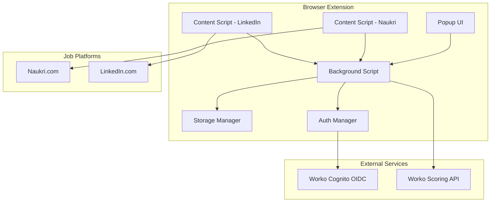
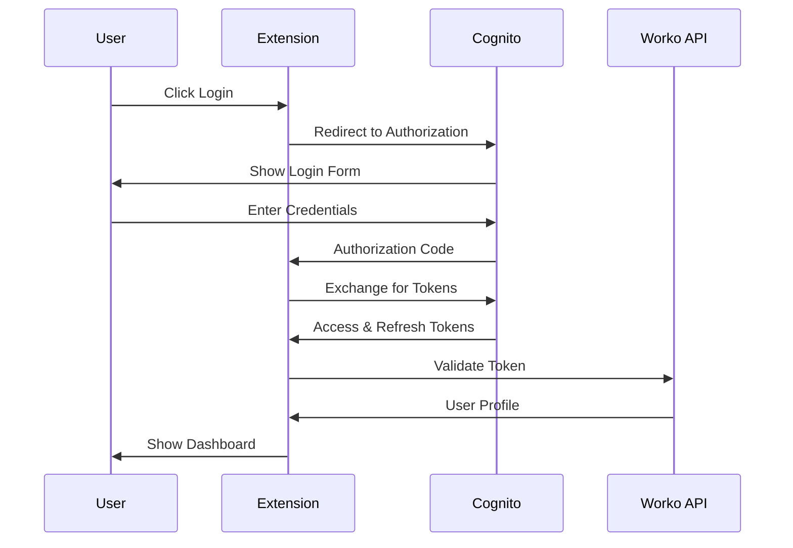

# Design Document - Worko Browser Extension Phase 1

## Overview

The Worko Browser Extension is a cross-browser extension that integrates with job platforms (Naukri and LinkedIn) to provide real-time job matching scores. The extension uses a multi-component architecture with background scripts, content scripts, and popup interfaces to deliver seamless job scoring functionality while maintaining security and performance.

## Architecture

### High-Level Architecture



### Component Architecture

1. **Popup Interface**: Main user interface for authentication, score history, and controls
2. **Background Script**: Central coordinator handling API calls, authentication, and data management
3. **Content Scripts**: Platform-specific scripts for job description extraction
4. **Storage Manager**: Secure data persistence and retrieval
5. **Authentication Manager**: OIDC flow handling and token management

## Components and Interfaces

### 1. Popup Interface (`popup.html`, `popup.js`, `popup.css`)

**Purpose**: Primary user interface for the extension

**Key Features**:
- Authentication interface with Worko login
- Dashboard showing last 5 scored jobs with color-coded results
- Job scoring controls and status indicators
- Settings and logout functionality

**Interface Design**:

#### Login State
```
┌─────────────────────────────┐
│    🚀 Worko Job Matcher    │
├─────────────────────────────┤
│                             │
│   Welcome to Worko!         │
│                             │
│   Connect your account to   │
│   start scoring jobs        │
│                             │
│   ┌─────────────────────┐   │
│   │   🔐 Login with     │   │
│   │      Worko          │   │
│   └─────────────────────┘   │
│                             │
│   Secure OIDC Authentication│
└─────────────────────────────┘
```

#### Main Dashboard
```
┌─────────────────────────────┐
│ 🚀 Worko Job Matcher       │
├─────────────────────────────┤
│ 👤 John Doe                │
│ ⚙️ Settings    🚪 Logout    │
├─────────────────────────────┤
│ 📊 Recent Job Scores        │
│                             │
│ 🟢 Software Engineer   85%  │
│    TechCorp • Naukri        │
│    [View] [Apply Now]       │
│                             │
│ 🟡 Product Manager     62%  │
│    StartupXYZ • LinkedIn    │
│    [View] [Apply Now]       │
│                             │
│ 🟠 Data Analyst        45%  │
│    DataCorp • Naukri        │
│    [View] [Apply Now]       │
│                             │
│ 🔴 DevOps Engineer     28%  │
│    CloudTech • LinkedIn     │
│    [View] [Apply Now]       │
│                             │
│ 🟡 UI Designer         71%  │
│    DesignStudio • Naukri    │
│    [View] [Apply Now]       │
│                             │
├─────────────────────────────┤
│ ┌─────────────────────────┐ │
│ │  📈 Score Current Job   │ │
│ └─────────────────────────┘ │
└─────────────────────────────┘
```

#### Job Scoring in Progress
```
┌─────────────────────────────┐
│ 🚀 Worko Job Matcher       │
├─────────────────────────────┤
│ 📊 Analyzing Job...         │
│                             │
│ 🔄 Extracting job details   │
│ ✅ Sending to Worko API     │
│ ⏳ Calculating match score  │
│                             │
│ ┌─────────────────────────┐ │
│ │ ████████████░░░░  75%   │ │
│ └─────────────────────────┘ │
│                             │
│ Please wait while we        │
│ analyze this opportunity... │
└─────────────────────────────┘
```

#### Score Results Detail View
```
┌─────────────────────────────┐
│ 🚀 Worko Job Matcher       │
├─────────────────────────────┤
│ 🟢 85% Match Score          │
│                             │
│ 📋 Software Engineer        │
│ 🏢 TechCorp                 │
│ 📍 Bangalore, India         │
│                             │
│ 📊 Score Breakdown:         │
│ Skills Match      🟢 92%    │
│ Experience        🟢 85%    │
│ Location          🟡 70%    │
│ Industry          🟢 95%    │
│                             │
│ ✅ Matching Skills:         │
│ • JavaScript, React, Node   │
│ • AWS, Docker, MongoDB      │
│                             │
│ ⚠️ Missing Skills:          │
│ • Kubernetes, GraphQL       │
│                             │
│ ┌─────────────────────────┐ │
│ │     🎯 Apply Now        │ │
│ └─────────────────────────┘ │
│                             │
│ [← Back to Dashboard]       │
└─────────────────────────────┘
```

### 2. Background Script (`background.js`)

**Purpose**: Central service worker managing all extension operations

**Key Responsibilities**:
- Handle authentication flow coordination
- Manage API communications with Worko services
- Coordinate between popup and content scripts
- Handle data persistence and retrieval
- Manage extension lifecycle events

**API Interface**:
```javascript
// Message handling interface
{
  type: 'AUTHENTICATE' | 'SCORE_JOB' | 'GET_HISTORY' | 'APPLY_JOB',
  payload: any,
  tabId?: number
}
```

### 3. Content Scripts

#### Content Script UI Integration

**Naukri Integration**:
```
┌─────────────────────────────────────────────────────────┐
│ Naukri.com - Job Details Page                          │
├─────────────────────────────────────────────────────────┤
│ Software Engineer - TechCorp                           │
│ 💰 ₹8-12 LPA  📍 Bangalore  ⏰ 2-5 years             │
│                                                         │
│ ┌─────────────────────────────────────────────────────┐ │
│ │ 🚀 Worko Job Matcher                    [Score Job] │ │ ← Injected
│ └─────────────────────────────────────────────────────┘ │
│                                                         │
│ Job Description:                                        │
│ We are looking for a skilled Software Engineer...      │
│                                                         │
│ Requirements:                                           │
│ • 3+ years experience in JavaScript                    │
│ • Experience with React, Node.js                       │
│ ...                                                     │
└─────────────────────────────────────────────────────────┘
```

**LinkedIn Integration**:
```
┌─────────────────────────────────────────────────────────┐
│ LinkedIn - Job Details                                  │
├─────────────────────────────────────────────────────────┤
│ Product Manager at StartupXYZ                          │
│ 📍 Remote  ⏰ Full-time  👥 50-200 employees           │
│                                                         │
│ ┌─────────────────────────────────────────────────────┐ │
│ │ 🚀 Worko Match: 62% 🟡        [View Details] [Apply]│ │ ← Injected
│ └─────────────────────────────────────────────────────┘ │
│                                                         │
│ About the job                                           │
│ We're seeking a Product Manager to lead our...         │
│                                                         │
│ [Easy Apply] [Save] [More...]                          │
└─────────────────────────────────────────────────────────┘
```

**Floating Action Button (Alternative)**:
```
                                    ┌─────────────────┐
                                    │ 🚀 Worko        │
                                    │                 │
                                    │ Score: 85% 🟢   │
                                    │                 │
                                    │ [View] [Apply]  │
                                    └─────────────────┘
                                           ↑
                                    Floating overlay
```

#### Naukri Content Script (`content-naukri.js`)

**Purpose**: Extract job descriptions from Naukri job pages

**Key Features**:
- Detect job listing pages
- Extract job title, company, description, and requirements
- Inject scoring UI elements
- Handle "Apply Now" redirections

**Job Data Extraction**:
```javascript
interface NaukriJobData {
  title: string;
  company: string;
  description: string;
  requirements: string;
  location: string;
  url: string;
  platform: 'naukri';
}
```

#### LinkedIn Content Script (`content-linkedin.js`)

**Purpose**: Extract job descriptions from LinkedIn job pages

**Key Features**:
- Detect LinkedIn job pages
- Extract job information from LinkedIn's dynamic content
- Handle LinkedIn's SPA navigation
- Inject scoring UI elements

**Job Data Extraction**:
```javascript
interface LinkedInJobData {
  title: string;
  company: string;
  description: string;
  requirements: string;
  location: string;
  url: string;
  platform: 'linkedin';
}
```

### 4. Authentication Manager (`auth.js`)

**Purpose**: Handle OIDC authentication flow with Worko Cognito

**Key Features**:
- Initiate OIDC authorization flow
- Handle callback and token exchange
- Manage token refresh
- Secure token storage

**Authentication Flow**:


### 5. Storage Manager (`storage.js`)

**Purpose**: Secure data persistence using browser storage APIs

**Data Schema**:
```javascript
interface StorageSchema {
  auth: {
    accessToken: string;
    refreshToken: string;
    expiresAt: number;
    userProfile: UserProfile;
  };
  jobHistory: JobScore[];
  settings: {
    autoScore: boolean;
    notifications: boolean;
  };
}

interface JobScore {
  id: string;
  jobData: JobData;
  score: number;
  breakdown: ScoreBreakdown;
  timestamp: number;
  applied: boolean;
}
```

## Data Models

### User Profile
```javascript
interface UserProfile {
  id: string;
  email: string;
  name: string;
  skills: string[];
  experience: number;
  preferences: JobPreferences;
}
```

### Job Data
```javascript
interface JobData {
  title: string;
  company: string;
  description: string;
  requirements: string;
  location: string;
  url: string;
  platform: 'naukri' | 'linkedin';
  extractedAt: number;
}
```

### Score Response
```javascript
interface ScoreResponse {
  score: number; // 0-100
  breakdown: {
    skillsMatch: number;
    experienceMatch: number;
    locationMatch: number;
    industryMatch: number;
  };
  recommendations: string[];
  matchingKeywords: string[];
  missingSkills: string[];
}
```

## Error Handling

### Authentication Errors
- **Token Expiry**: Automatic refresh using refresh token
- **Invalid Credentials**: Clear storage and redirect to login
- **Network Errors**: Retry with exponential backoff
- **OIDC Errors**: Display user-friendly error messages

### API Errors
- **Rate Limiting**: Queue requests and implement backoff
- **Service Unavailable**: Show offline mode with cached data
- **Invalid Job Data**: Validate and sanitize before sending
- **Scoring Failures**: Provide fallback messaging

### Content Script Errors
- **Page Structure Changes**: Graceful degradation with error reporting
- **Permission Denied**: Request necessary permissions
- **Injection Failures**: Fallback to popup-only mode

## Testing Strategy

### Unit Testing
- **Authentication Manager**: Mock OIDC flows and token handling
- **Storage Manager**: Test data persistence and retrieval
- **Job Data Extractors**: Test with sample HTML fixtures
- **API Client**: Mock API responses and error conditions

### Integration Testing
- **End-to-End Authentication**: Test complete OIDC flow
- **Job Scoring Workflow**: Test from extraction to display
- **Cross-Platform Compatibility**: Test on Chrome, Firefox, Edge
- **Content Script Injection**: Test on actual job platform pages

### Manual Testing
- **User Experience**: Test complete user workflows
- **Performance**: Monitor memory usage and response times
- **Security**: Verify token handling and data protection
- **Accessibility**: Ensure keyboard navigation and screen reader support

## Security Considerations

### Token Security
- Store tokens in encrypted browser storage
- Implement secure token refresh mechanism
- Clear tokens on logout and extension uninstall
- Use HTTPS for all API communications

### Content Security Policy
```json
{
  "content_security_policy": {
    "extension_pages": "script-src 'self'; object-src 'self'"
  }
}
```

### Permissions
```json
{
  "permissions": [
    "storage",
    "activeTab",
    "identity"
  ],
  "host_permissions": [
    "https://www.naukri.com/*",
    "https://www.linkedin.com/*",
    "https://api.worko.ai/*"
  ]
}
```

### Data Privacy
- Minimize data collection to essential job matching information
- Implement data retention policies
- Provide clear privacy controls in settings
- Ensure GDPR compliance for user data handling

## UI/UX Design Specifications

### Color Scheme
```css
:root {
  --worko-primary: #2563eb;      /* Blue */
  --worko-success: #16a34a;      /* Green - >75% */
  --worko-warning: #eab308;      /* Yellow - 50-74% */
  --worko-amber: #f59e0b;        /* Amber - 30-49% */
  --worko-danger: #dc2626;       /* Red - <30% */
  --worko-background: #ffffff;
  --worko-surface: #f8fafc;
  --worko-text: #1e293b;
  --worko-text-secondary: #64748b;
}
```

### Typography
- **Primary Font**: Inter, system-ui, sans-serif
- **Headings**: 16px (H1), 14px (H2), 12px (H3)
- **Body Text**: 12px regular, 11px secondary
- **Buttons**: 12px medium weight

### Component Specifications

#### Score Badge
```css
.score-badge {
  display: inline-flex;
  align-items: center;
  padding: 4px 8px;
  border-radius: 12px;
  font-weight: 600;
  font-size: 11px;
}

.score-green { background: #dcfce7; color: #166534; }
.score-yellow { background: #fef3c7; color: #92400e; }
.score-amber { background: #fed7aa; color: #9a3412; }
.score-red { background: #fecaca; color: #991b1b; }
```

#### Job History Item
```css
.job-item {
  padding: 12px;
  border-radius: 8px;
  border: 1px solid #e2e8f0;
  margin-bottom: 8px;
  background: white;
}

.job-item:hover {
  border-color: var(--worko-primary);
  box-shadow: 0 2px 4px rgba(37, 99, 235, 0.1);
}
```

### Responsive Design
- **Extension Width**: 320px (fixed)
- **Extension Height**: 480px (max, scrollable)
- **Minimum Height**: 200px
- **Content Script Overlays**: Responsive to page layout

### Animation Guidelines
- **Transitions**: 200ms ease-in-out for hover states
- **Loading States**: Smooth progress bars and spinners
- **Score Reveals**: Gentle fade-in with scale animation
- **Navigation**: Slide transitions between views

## Performance Optimization

### Content Script Optimization
- Lazy load content scripts only on relevant pages
- Use efficient DOM selectors and caching
- Implement debouncing for dynamic content detection
- Minimize memory footprint

### API Optimization
- Implement request caching for repeated job scores
- Use compression for large job descriptions
- Batch multiple requests when possible
- Implement intelligent retry mechanisms

### Storage Optimization
- Limit job history to last 50 entries
- Compress stored job data
- Implement periodic cleanup of expired data
- Use efficient data structures for quick retrieval